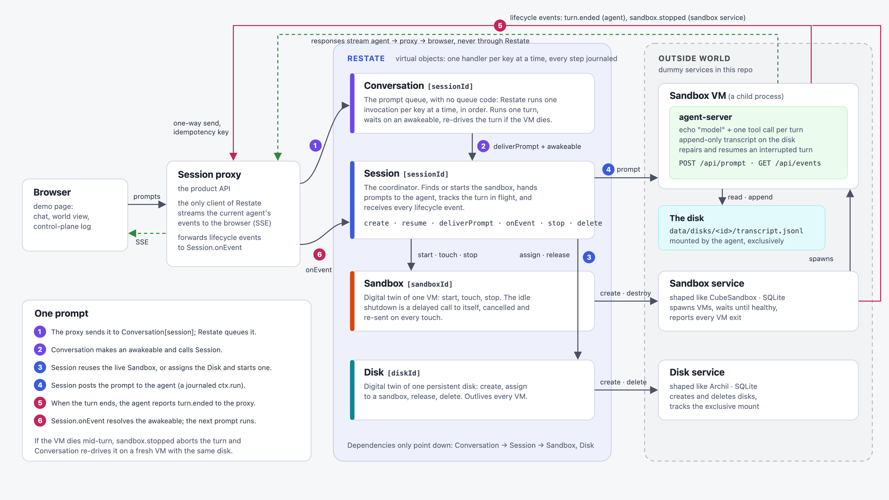

# Agent sessions on Restate

The control plane of an AI-agent harness, written as four small [Restate](https://restate.dev)
virtual objects.

Each agent session runs in a disposable sandbox VM, with its conversation on a persistent
network disk. VMs are destroyed after a few idle minutes, and the next prompt boots a fresh VM
on the same disk. Prompts must be delivered exactly once, in order, one turn at a time. A VM
that dies mid-turn must not lose the turn.

That's a lot of distributed-systems machinery: locks, queues, retries, timers, crash recovery.
Here, Restate provides all of it, and the handlers read like the flow they implement.



The numbered steps trace one prompt. The source is [`docs/architecture.svg`](docs/architecture.svg).

For just the processes and the protocols between them, see
[`docs/processes.png`](docs/processes.png) ([source](docs/processes.svg)).

| Object | Role | Restate primitives on show |
|---|---|---|
| [`Conversation[sessionId]`](src/restate/conversation.ts) | The prompt queue, with no queue code: each prompt is a one-way send, and Restate runs one invocation per key at a time, in order. Runs one turn and waits for it to finish. Re-drives the turn if the VM dies. | per-key serialization, awakeables, timeouts |
| [`Session[sessionId]`](src/restate/session.ts) | The coordinator: finds or starts the sandbox, hands prompts to the agent, tracks the turn in flight, receives every lifecycle event. | calls between objects, `ctx.run`, resolving awakeables, shared handlers |
| [`Sandbox[sandboxId]`](src/restate/sandbox.ts) | An opaque VM: boot, touch, destroy. The idle shutdown is a delayed call to itself, cancelled and re-sent on every touch. | durable timers (delayed sends + cancellation) |
| [`Disk[diskId]`](src/restate/disk.ts) | An opaque disk: create, assign to a sandbox, release, delete. | `ctx.run` with bounded retries |

The rest of the repo plays the outside world, so you can run the whole thing on a laptop:

- **[Dummy sandbox service](src/services/sandboxes/main.ts)**, shaped like CubeSandbox. Each "VM" is a child process.
- **[Dummy disk service](src/services/disks/main.ts)**, shaped like Archil. Each disk is a directory, with exclusive mounts.
- **[Fake agent-server](src/services/agent/main.ts)**: an echo "model" with a simulated tool call. It keeps an append-only transcript on the disk, and repairs and resumes a turn its predecessor didn't finish.
- **[Session proxy](src/proxy/main.ts)**: the product API. It's the only thing that talks to Restate, and it serves a demo page.

The full design is in [SPEC.md](SPEC.md).

## Run it

You need Node 22+ and `restate-server` (`brew install restatedev/tap/restate-server`, or see the
[Restate docs](https://docs.restate.dev)).

```bash
npm install
npm run dev        # starts everything; open http://localhost:3000
npm run reset      # wipe all state (stop the stack first)
```

`npm run dev` uses a 30-second idle timeout so you don't have to wait 10 minutes. Logs are in
`data/logs/`, and the Restate UI at http://localhost:9070 shows every invocation and its
journal.

## Things to try

The page's **Architecture** link opens the diagram above, which is handy to keep beside the
demo. The page shows sessions, sandboxes and disks. Each sandbox and disk row puts Restate's twin
next to the dummy service's real record. Below that is a chat panel, and a control-plane log
of what each object is doing.

1. **New session.** Watch the log: Session creates its Disk, starts a Sandbox, and the agent mounts the disk and takes the first turn.
2. **Send ×3** while a turn runs. The extra prompts show as *queued*: they're waiting in Restate's own queue for `Conversation[session]`, and run one after another.
3. **kill -9** a sandbox mid-turn. The turn is aborted, `Conversation` boots a new VM, and the new agent finds the unfinished turn in the transcript, closes the dangling tool call, and completes the turn.
4. **Wait 30 s**, or click **expire idle**. The VM gets its shutdown hook and is destroyed. Send another prompt: a new VM boots on the same disk, and the agent carries on the conversation.
5. **Stop** with prompts queued. It returns at once. The turn in flight is aborted, and the queued prompts are rejected.
6. **Delete.** The VM and the disk are removed, and the session refuses further prompts.
7. **Restart the stack** (Ctrl-C, `npm run dev`) mid-conversation. VMs that died while the stack was down are reported, the twins catch up, and the next prompt carries on.

## Layout

```
src/restate/      the four virtual objects (start here)
src/clients/      typed clients the handlers call inside ctx.run
src/services/     dummy sandbox service, dummy disk service, fake agent
src/proxy/        session proxy and the demo page
src/config.ts     ports and every timeout (each wait in the system has one)
src/dev.ts        starts the stack
```
